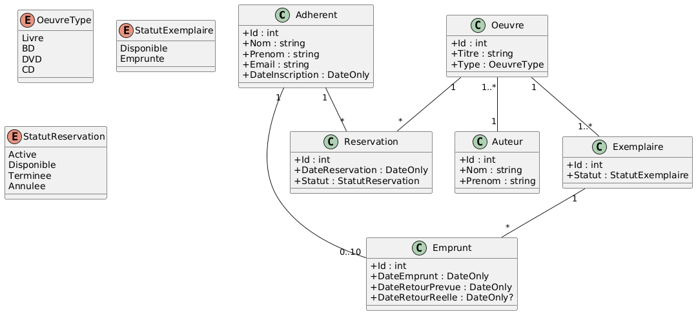
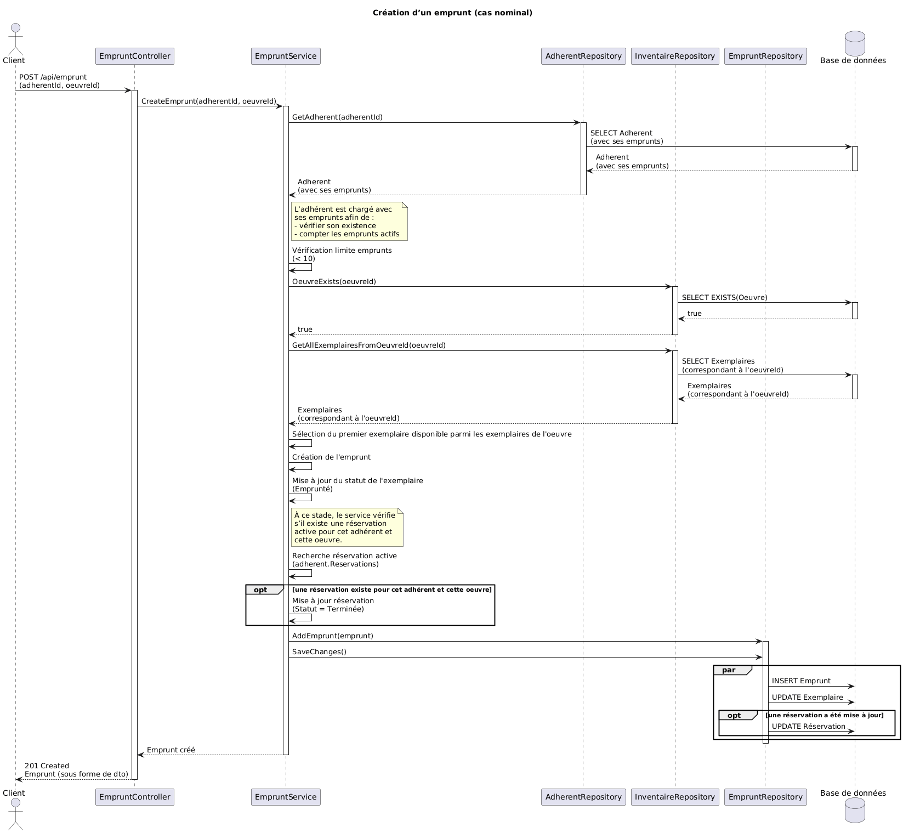

# Projet génie logiciel 2025 : MédiathèqueWeb

---

Lina AMMAR-BOUDJELAL\
Thiméo TONON\
Charlotte NICKERSON

Groupe 1 - Promotion 2027

***Remarque concernant l’équipe*** *: Le dépôt Git ne contient que le nom de deux des membres de l’équipe dans son intitulé. Le troisième membre a rejoint le groupe après le démarrage du projet, ce qui explique son absence dans le nom initial du dépôt.*

---

Sommaire : 
- [1. Présentation du projet](#1-présentation-du-projet)
- [2. Procédure d'installation](#2-procédure-dinstallation)
- [3. Diagramme de classes UML (modèle métier)](#3-diagramme-de-classes-uml-modèle-métier)
- [4. Diagramme de séquence UML - Création d'un emprunt](#4-diagramme-de-séquence-uml---création-dun-emprunt)

---

## 1. Présentation du projet

Ce projet consiste en la réalisation d'un service web back-end pour une médiathèque.\
Il permet de gérer l'inventaire (oeuvres, auteurs des oeuvres, et exemplaires), ainsi les adhérents et leurs emprunts et réservations associées.

L'application expose une API REST développée en APS.NET Core (.NET 9) et repose sur une base de données SQLite via Entity Framework Core.\
L'architecture respecte une séparation claire des responsabilités entre contrôleurs, services et repositories, conformément aux principes SOLID.

## 2. Procédure d’installation

Prérequis : 
- .NET SDK 9
- Git

> Étapes d'installation 
```
git clone https://github.com/ensc-glog/glog-classroom-project-ammarboudjelallina_tononthimeo.git
cd glog-classroom-project-ammarboudjelallina_tononthimeo
cd MediathequeWeb
dotnet build
dotnet ef database update
dotnet run
```

Le service est disponible à l'adresse : 
- API : http://localhost:7044/api
- Scalar : http://localhost:7044/scalar/

Lors du premier lancement, des données initiales sont injectées automatiquement si la base de données est vide.

## 3. Diagramme de classes UML (modèle métier)

Le diagramme suivant représente le modèle métier principal de l'application (Adhérent, Emprunt, Réservation, Oeuvre, Auteurs, Exemplaire).



## 4. Diagramme de séquence UML - Création d'un emprunt

Ce diagramme de séquence illustre le déroulement complet d’un emprunt passant
(cas nominal), depuis l’appel HTTP jusqu’à la persistance en base de données.

Le scénario correspond à l'appel : `POST /api/emprunt`.



